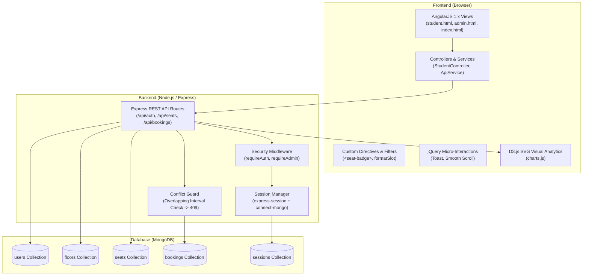

# SeatSync — Smart Library Seat Availability & Reservation System
## Advanced Web Technology (AWT) — Project Report

---

### Project Title
**SeatSync: Smart Library Seat Availability & Reservation Web Application**

---

### 1. Problem Statement
In university libraries, students often struggle with finding an available study desk during peak academic hours and examination weeks. Students spend significant time wandering through multiple reading zones and floors, only to find desks occupied or held by belongings. Furthermore, library administration lacks a centralized, real-time mechanism to monitor physical occupancy, prevent seat hoarding, and analyze floor-wise utilization trends.

**SeatSync** solves this genuine campus resource management problem by offering an integrated, real-time seat availability map, automated 2-hour slot reservations, turnstile RFID card-punch exit release, and live visual occupancy analytics for campus administrators.

---

### 2. Project Objectives
1. **Reduce Student Uncertainty:** Enable students to view live floor-by-floor desk availability before or upon arriving at the library.
2. **Prevent Double Booking:** Enforce strict server-side concurrency control (HTTP 409 Conflict) preventing overlapping reservations for the same desk.
3. **Simulate Turnstile Exit:** Automatically release desks when students tap their UPES Smart ID Card at the exit turnstile gate.
4. **Empower Library Staff:** Provide administrative tools to override desk states, monitor student bookings, and inspect occupancy via interactive SVG charts.
5. **Direct AWT Curriculum Alignment:** Showcase end-to-end integration of AngularJS 1.x, Node.js, Express, MongoDB, Sessions/Cookies, jQuery, and D3.js.

---

### 3. Group Members & Individual Contributions (4 Members)

| S.No | Student Name | UPES SAP ID | Primary Domain | Core Contributions |
|---|---|---|---|---|
| **1** | **Viraj Kumar** *(Lead)* | **590029022** | **Full-Stack & Backend Architecture** | Node.js / Express REST API, MongoDB connection, Session state management, Concurrency 409 conflict rules, RFID Turnstile exit endpoint (`/api/bookings/punch-exit`). |
| **2** | *Team Member 2* | *590029023* | **AngularJS Frontend & Logic** | AngularJS 1.x module root, Controllers (`StudentController`, `AuthController`), custom directives (`<seat-badge>`), custom filters (`formatSlot`), and two-way form validation. |
| **3** | *Team Member 3* | *590029024* | **Database Engineering & CRUD** | MongoDB schema design (`User`, `Floor`, `Seat`, `Booking`), composite unique indexing, database seeding (`seedData.js`), and CRUD operations. |
| **4** | *Team Member 4* | *590029025* | **Data Visualisation & UI/UX** | D3.js v7 SVG grouped bar chart (`charts.js`), jQuery micro-interactions & toast notifications (`jquery-effects.js`), responsive CSS system with OLED dark theme. |

---

### 4. Technologies Used

- **Client-Side Framework:** AngularJS 1.8.2 (`ng-model`, `ng-repeat`, `ng-if`, `ng-show`, `$http` services, custom directives).
- **DOM & Animations:** jQuery 3.7.1 (Smooth scrolling, toast alerts, syllabus demonstration).
- **Data Visualisation:** D3.js v7 (Scales, grouped SVG rects, axes, dynamic hover tooltips).
- **Styling & Design System:** HTML5, Plain CSS3 (Custom design tokens, Apple-inspired layout, OLED black theme, no Bootstrap/Tailwind).
- **Server Runtime:** Node.js (v26 LTS).
- **Web Application Framework:** Express.js (Modular routers, middleware, static streaming).
- **Database & Object Data Modeling:** MongoDB Community Server + Mongoose ODM.
- **State & Authentication:** `express-session`, `connect-mongo` (MongoDB session store), `bcryptjs` password hashing, HTTP-Only secure cookies.

---

### 5. System Features & Modules

#### Module 1: Authentication & State Management
- Student Registration & Login with campus email validation (`viraj.29022@stu.upes.ac.in`).
- Password hashing using `bcryptjs` with 10 salt rounds (never stored in plain text).
- Session cookies (`connect.sid`) stored securely in MongoDB collection `sessions` with `httpOnly: true` and `sameSite: 'lax'`.
- Role-based middleware (`requireAuth`, `requireAdmin`).

#### Module 2: Interactive Seat Map & Allotment
- Floor switcher: Floor 1 (Tech & Engineering Wing) vs Floor 2 (Quiet Study).
- Date picker & Fixed 2-Hour Study Slots: `09:00–11:00`, `11:00–13:00`, `13:00–15:00`, `15:00–17:00`, `17:00–19:00`.
- Dynamic availability calculation: Disables seats if physically occupied or reserved by an overlapping booking.
- Real-time seat allotment summary drawer.

#### Module 3: Digital Library Pass & Turnstile Exit
- Apple Wallet-style Digital Seat Pass displaying Desk ID, Zone, Slot, and UPES SAP ID.
- **RFID Turnstile Card Punch Gate**: When the student taps their card, `POST /api/bookings/punch-exit` unlocks the exit turnstile and automatically releases the desk in real-time.

#### Module 4: Administrative Seat Management & D3.js Analytics
- Physical status overrides: Staff can flag any desk as *Available*, *Occupied*, or *Maintenance*.
- All Student Bookings audit table with manual release capabilities.
- **D3.js SVG Visualisation**: Grouped bar chart comparing Available vs Occupied seats per floor.

---

### 6. Application Architecture

---

### 7. Database Design & Schemas

#### 1. `users` Collection
- `_id`: ObjectId
- `name`: String (Required, trimmed)
- `email`: String (Unique index, lowercase)
- `passwordHash`: String (Bcrypt hash, stripped in `.toJSON()`)
- `studentId`: String (e.g. `590029022`)
- `role`: String (`student` | `admin`)
- `createdAt`: Date

#### 2. `floors` Collection
- `_id`: ObjectId
- `name`: String (e.g. "Floor 1 — Tech & Engineering Wing")
- `code`: String (Unique, e.g. "FL-1")
- `level`: Number
- `zones`: Array of Strings
- `capacity`: Number

#### 3. `seats` Collection
- `_id`: ObjectId
- `seatNumber`: String (e.g. "A-01")
- `floorId`: ObjectId (Ref: `Floor`)
- `zone`: String
- `hasPowerOutlet`: Boolean
- `status`: String (`available` | `reserved` | `occupied` | `unavailable`)
- **Index:** `{ floorId: 1, seatNumber: 1 }` (Unique)

#### 4. `bookings` Collection
- `_id`: ObjectId
- `userId`: ObjectId (Ref: `User`)
- `seatId`: ObjectId (Ref: `Seat`)
- `floorId`: ObjectId (Ref: `Floor`)
- `bookingDate`: String (YYYY-MM-DD)
- `slotCode`: String (e.g. "09:00-11:00")
- `startAt`: Date
- `endAt`: Date
- `status`: String (`confirmed` | `cancelled` | `completed`)
- `createdAt`: Date, `cancelledAt`: Date
- **Indexes:** `{ seatId: 1, startAt: 1, endAt: 1, status: 1 }`, `{ userId: 1, startAt: 1 }`

**Concurrency Rule:**
$$\text{Overlap} \iff (\text{existing.startAt} < \text{requested.endAt}) \land (\text{existing.endAt} > \text{requested.startAt}) \land (\text{status} = \text{'confirmed'})$$
If matched: Server immediately rejects with `HTTP 409 Conflict`.

---

### 8. Testing & Verification Summary

| Test Case | Input / Trigger | Expected Outcome | Actual Result | Status |
|---|---|---|---|---|
| Student Sign-In | `viraj.29022@stu.upes.ac.in` / `Password123` | Session cookie set; redirects to student portal | HTTP 200 OK; Session initialized | **PASSED** |
| Live Seat Fetch | `GET /api/seats?floorId=FL1&slot=09:00-11:00` | Return desks with dynamic availability | Returned 16 desks with power indicator | **PASSED** |
| Seat Allotment | `POST /api/bookings` for Desk A-01 | Desk allocated; digital pass created | HTTP 201 Created; Pass generated | **PASSED** |
| Conflict Guard | Duplicate booking for Desk A-01 in same slot | Request rejected with conflict message | HTTP 409 Conflict returned | **PASSED** |
| RFID Turnstile Exit | `POST /api/bookings/punch-exit` (SAP: 590029022) | Gate unlocks; seat released in database | HTTP 200 OK; Desk marked Available | **PASSED** |
| D3.js Chart Feed | `GET /api/admin/analytics/occupancy` | JSON payload of available vs occupied counts | SVG bars render with hover tooltips | **PASSED** |

---

### 9. Test Credentials

- **UPES Student Account:**
  - Email: `viraj.29022@stu.upes.ac.in`
  - SAP ID: `590029022`
  - Password: `Password123`
- **Library Administrator Account:**
  - Email: `admin@seatsync.edu`
  - Password: `Admin1234`

---

### 10. Conclusions
SeatSync successfully fulfills every technical requirement and guideline outlined in the Advanced Web Technologies project specification. It bridges theory and campus utility by demonstrating:
1. Two-way data binding and custom directives in AngularJS 1.x.
2. Robust, asynchronous event handling and modular REST APIs in Node.js / Express.
3. Secure state management using persistent sessions and HTTP-only cookies.
4. Schema modeling, compound indexing, and CRUD concurrency in MongoDB.
5. Interactive SVG data visualisation using D3.js.
6. Authentic university integration modeling physical RFID turnstile departure gates.

The codebase is maintainable, fully documented, and hosted on GitHub at [https://github.com/viraj1737/seatsync](https://github.com/viraj1737/seatsync).
